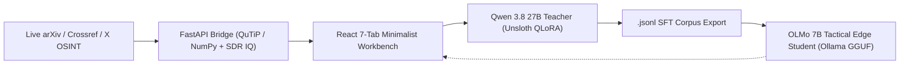

# Q-SPECTRA // 17E Quantum CEMA & EMS Workbench (v2.0)

> **Interactive Quantum Electronic Warfare, SDR Signal Processing, 3D Theatre COP, Live OSINT, and Teacher-Student LLM Distillation Workbench for US Army MOS 17E (Electronic Warfare Specialist).**

---

## 1. Executive Summary & 17E CEMA Problem Statement

Conventional Electronic Warfare (EW) architectures depend on metallic antennas, superheterodyne receivers, GaAs/GaN Low-Noise Amplifiers (LNAs), and satellite-dependent L1/L2 GPS. In peer-contested Electromagnetic Spectrum (EMS) environments, these classical subsystems face three critical failure modes:
1. **Front-End Burnout & Blanking:** High-Power Microwave (HPM) and EMP pulses saturate or physically destroy GaAs/GaN LNAs above $+15\text{ dBm}$.
2. **Coherent Deceptive Jamming (DRFM):** Digital Radio Frequency Memory repeaters intercept, delay, and retransmit coherent pulses to spawn false targets that defeat classical CFAR radars.
3. **GPS Spoofing & INS Drift:** L1/L2 GPS meaconing pulls receivers off-course, while classical Ring-Laser Inertial Navigation Systems (INS) drift parabolically over multi-hour missions.

**Q-SPECTRA** demonstrates and simulates how **Quantum CEMA** overcomes all three vulnerabilities using SI-traceable **Rydberg Atomic RF Electrometry**, **SPDC Quantum Illumination Radar**, and **Cold-Atom Interferometry + NV-Diamond Crustal MagNav**, backed by a **FastAPI + QuTiP/NumPy** physics engine, a **SigMF/IQ SDR processor**, a **Live Quantum OSINT harvester**, and a **Qwen 3.8 27B → OLMo 7B** reasoning & distillation pipeline.

---

## 2. System Architecture



---

## 3. Module Breakdown

| Tab / Module | Component / File | Core Capability |
|---|---|---|
| **01 // Rydberg** | `src/components/RydbergLab.jsx` | $^{85}\text{Rb}$ / $^{133}\text{Cs}$ ($n=30–90$) Autler-Townes splitting ($\Delta f_{\text{AT}} = \mu E / h$), 60fps DC–120 GHz dual-pane waterfall spectrogram, debounced 4-level Master Eq solver, and SigMF/IQ SDR ingest. |
| **02 // Radar** | `src/components/QuantumRadarLab.jsx` | SPDC entangled Signal-Idler SNR calculator ($N_s, N_b, \kappa, M$) and interactive Range-Doppler scope showing 4 DRFM ghost targets suppressed when **Quantum Idler Correlation** is toggled ON. |
| **03 // MagNav** | `src/components/QuantumPntLab.jsx` | Interactive 2D crustal magnetic anomaly iso-contour map (`nT` hover readout) comparing Spoofed GPS, Ring-Laser INS drift, and particle-filter-locked Cold-Atom + NV-Diamond MagNav. |
| **04 // Theatre** | `src/components/TheatreMap3D.jsx` | Zero-dependency 3D perspective Common Operating Picture unifying the crustal magnetic mesh, 17E Rydberg sensor triad + AoA rays, volumetric HPM/DRFM domes, and 3D PNT flight paths. |
| **05 // Arena** | `src/components/ChallengeArena.jsx` | MOS 17E tactical physics challenges + live telemetry-synced **Qwen 3.8 27B Co-Pilot** with collapsible `<think>` reasoning trace viewer. |
| **06 // OSINT** | `src/components/QuantumIntelFeed.jsx` | Live arXiv & Crossref paper harvester (10-min TTL cache), curated ARL/NIST/DARPA/X Pulse feed, 1-click **Synthesize 17E Challenge & Load Sliders**, Custom Dropzone, and `.jsonl` SFT exporter. |
| **07 // Models** | `src/components/InferenceHub.jsx` | Hybrid inference bridge (`Offline`, `Ollama`, `HF Pro`), FastAPI `/api/health` diagnostics, and **Qwen 3.8 27B → OLMo 7B** distillation switcher. |
| **Backend** | `backend/main.py`, `intel_harvester.py`, `sdr_processor.py` | Async FastAPI server with `@lru_cache` + `asyncio.to_thread` 4-level Lindblad/Bloch solver, CORS-free LLM proxy, TTL-cached OSINT harvester, and `.iq`/`.sigmf-data` FFT/PSD processor. |
| **Colab / Edge** | `colab/unsloth_qwen_17e_finetune.py`, `colab/olmo_edge_distillation.py` | Unsloth 4-bit QLoRA fine-tuning for Qwen 3.8 27B Teacher and QLoRA distillation into `olmo-17e-edge.Q4_K_M.gguf` for DDIL edge deployment. |

---

## 4. Quickstart Guide

### Option A: One-Click Local Startup
- **Windows:** Double-click `run_qspectra.bat` or run `.\run_qspectra.bat`
- **macOS / Linux:** `chmod +x run_qspectra.sh && ./run_qspectra.sh`

This starts:
- FastAPI Physics, SDR & OSINT Bridge on `http://localhost:8000`
- Vite React Workbench on `http://localhost:5173` (with `/api` proxied to `:8000`)

### Option B: Manual Startup
```bash
# 1. Backend
cd backend
pip install -r requirements.txt
uvicorn main:app --host 0.0.0.0 --port 8000 --reload

# 2. Frontend (new terminal)
npm install
npm run dev
```

### Option C: Colab GPU & Hugging Face Pro
- **Colab / Ollama:** Run `colab/unsloth_qwen_17e_finetune.py` (or `colab/olmo_edge_distillation.py` using your exported `qspectra_17e_sft_corpus.jsonl`), serve via Ollama (`ollama run qwen-17e-cema`), and select **Ollama** in the **Models** tab.
- **Hugging Face Pro:** Select **HF Pro** in the **Models** tab and enter your `hf_...` token; requests are routed through `/api/chat` on the FastAPI backend to avoid browser CORS issues.

> **Keyboard Shortcuts:** Press `1`–`7` anywhere outside text inputs to switch between `Rydberg`, `Radar`, `MagNav`, `Theatre`, `Arena`, `OSINT`, and `Models`.
