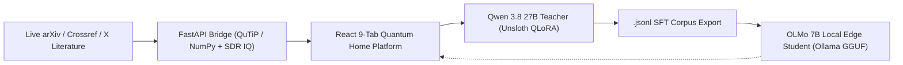

# Q-SPECTRA // Universal Quantum Home & Simulation Platform (v2.3)

> **Interactive Quantum Sensing, Quantum Circuit Simulation, BB84 QKD Cryptography, SDR Signal Processing, 3D EMS Visualization, Live Literature OSINT, and Teacher-Student LLM Distillation Platform.**

---

## 1. Executive Summary & Quantum Home Vision

**Q-SPECTRA** is a unified, browser-and-GPU quantum simulation platform designed for researchers, developers, engineers, and students exploring the four pillars of modern quantum technology:
1. **Quantum RF Metrology (Rydberg Sensing):** SI-traceable $^{85}\text{Rb}$ / $^{133}\text{Cs}$ vapor cell electrometry and 4-level ladder Optical Bloch / QuTiP Lindblad modeling for atmospheric, laboratory, and high-field RF characterization.
2. **Quantum Illumination & Aerospace PNT:** SPDC entangled Signal-Idler SNR analysis in high thermal clutter and Cold-Atom Interferometry + NV-Diamond geomagnetic navigation (MagNav) for GNSS-denied aerospace corridors.
3. **Quantum Computing & Algorithms:** Browser-based 2–4 qubit complex state-vector simulator supporting universal gates ($H, X, Y, Z, P, R_x, R_y, R_z, \text{CNOT}$), Born-rule 1024-shot sampling, depolarizing gate-fidelity modeling, and benchmark presets (Bell $|\Phi^+\rangle$, 3-Qubit GHZ, Grover Oracle $|101\rangle$).
4. **Quantum Cryptography (BB84 QKD):** Interactive single-photon basis preparation (`+` vs. `×`), channel depolarizing noise, Eve intercept-resend simulation, and real-time QBER evaluation against the 11.0% Shor-Preskill security bound.

---

## 2. System Architecture



---

## 3. Module Breakdown

| Tab / Module | Component / File | Core Capability |
|---|---|---|
| **01 // Rydberg** | `src/components/RydbergLab.jsx` | $^{85}\text{Rb}$ / $^{133}\text{Cs}$ ($n=30–90$) Autler-Townes splitting ($\Delta f_{\text{AT}} = \mu E / h$), 300 K thermal vs. 100 μK MOT linewidth toggle, 60fps DC–120 GHz waterfall spectrogram, and SigMF/IQ SDR ingest. |
| **02 // Radar** | `src/components/QuantumRadarLab.jsx` | SPDC entangled Signal-Idler SNR calculator ($N_s, N_b, \kappa, M$) and interactive Range-Doppler scope showing coherent clutter targets suppressed when **Quantum Idler Correlation** is toggled ON. |
| **03 // MagNav** | `src/components/QuantumPntLab.jsx` | Interactive 2D crustal magnetic anomaly iso-contour map (`nT` hover readout) comparing GNSS interference, Ring-Laser INS drift, and Cold-Atom + NV-Diamond MagNav. |
| **04 // Theatre** | `src/components/TheatreMap3D.jsx` | Zero-dependency 3D perspective EMS Common Operating Picture unifying the crustal magnetic mesh, Rydberg sensor triad + AoA rays, volumetric RF/clutter domes, and 3D PNT flight paths. |
| **05 // Coding** | `src/components/QuantumCodingLab.jsx` | Interactive 2–4 qubit quantum circuit builder and complex state-vector simulator with 1024-shot Born-rule histogram, gate fidelity, and Bell / GHZ / Grover benchmarks. |
| **06 // Crypto** | `src/components/QuantumCryptoLab.jsx` | BB84 Quantum Key Distribution simulator with `+`/`×` basis controls, channel noise, Eve intercept-resend toggle, real-time QBER, and secret key rate readout. |
| **07 // Arena** | `src/components/ChallengeArena.jsx` | Applied quantum physics & metrology challenges + live telemetry-synced **Qwen 3.8 27B Co-Pilot** with collapsible `<think>` reasoning trace viewer. |
| **08 // OSINT** | `src/components/QuantumIntelFeed.jsx` | Live arXiv & Crossref paper harvester (10-min TTL cache), curated research feed, 1-click **Synthesize Challenge & Load Sliders**, Custom Dropzone, and `.jsonl` SFT exporter. |
| **09 // Models** | `src/components/InferenceHub.jsx` | Hybrid inference bridge (`Offline`, `Ollama`, `HF Pro`), FastAPI `/api/health` diagnostics, and **Qwen 3.8 27B → OLMo 7B** distillation switcher. |
| **Glossary** | `src/components/ParameterGlossary.jsx` | Persistent slide-over Parameter Glossary & Physics Guide explaining every slider and metric across all labs. |
| **Backend** | `backend/main.py`, `intel_harvester.py`, `sdr_processor.py` | Async FastAPI server with `@lru_cache` + `asyncio.to_thread` 4-level Lindblad/Bloch solver, CORS-free LLM proxy, TTL-cached literature harvester, and `.iq`/`.sigmf-data` FFT/PSD processor. |
| **Colab / Edge** | `colab/colab_live_backend.py`, `colab/olmo_edge_distillation.py` | Turnkey Colab GPU + `cloudflared`/`pyngrok` tunnel launcher and Unsloth 4-bit QLoRA distillation into `olmo-quantum-edge.Q4_K_M.gguf`. |

---

## 4. Quickstart Guide

### Option A: One-Click Local Startup
- **Windows:** Double-click `run_qspectra.bat` or run `.\run_qspectra.bat`
- **macOS / Linux:** `chmod +x run_qspectra.sh && ./run_qspectra.sh`

### Option B: Manual Startup
```bash
# 1. Backend
cd backend
pip install -r requirements.txt
uvicorn main:app --host 0.0.0.0 --port 8000 --reload

# 2. Frontend (new terminal)
npm install
npm run dev
```

### Option C: Automated Tests & Build
```bash
npm test
npm run build
python -m unittest backend/test_main.py
```

> **Keyboard Shortcuts:** Press `1`–`9` anywhere outside text inputs to switch between `Rydberg`, `Radar`, `MagNav`, `Theatre`, `Coding`, `Crypto`, `Arena`, `OSINT`, and `Models`.
